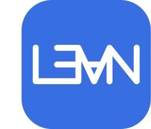

# Danzel Serrano

**PhD student @ NJIT** · advised by [Przemyslaw Musialski](https://github.com/pmusialski)

---

### 🧠 What I'm working on

- 🔊 **Audio ↔ geometry.** My research program is the two-way street between sound and 3D motion — audio that informs geometry, geometry that informs audio — aimed at synthesis that stays controllable and physics-grounded
- 🎓 **Dissertation:** speech-driven 3D facial animation. Most recently, disentangled phoneme–prosody mapping so the *what* and the *how* of speech can be steered independently — [ACM SIGGRAPH Posters '25](https://danzelserrano.com)
- 🌊 **Broader research:** procedural audio models of environmental sounds, physics-based sound simulation, and implicit neural representations — including [HOSC](https://danzelserrano.com), a periodic activation with saturation control
- 🎙️ **Sensorium AI** — real-time voice synthesis from disentangled speech factors, for performance and accessibility
- 🧰 **[gffx](https://github.com/dependanz/gffx)** — A graphics, geometry, and mesh toolkit with differentiable operations. Requires only Python and PyTorch.
- 🥤 **[colabcola](https://github.com/dependanz/colabcola)** — A toolkit for connecting local Python workflows to Google Colab — [Website](https://colabcola.com).

### 📌 Featured work

| Project | What it is |
| --- | --- |
| [**Colab Cola**](https://github.com/dependanz/colabcola) · [Website](https://colabcola.com) | Run reproducible Python jobs on Google Colab from your terminal. |
| [**gffx**](https://github.com/dependanz/gffx) | A graphics, geometry, and mesh toolkit with differentiable operations. Requires only Python and PyTorch. |
| [**hippo-campus.io**](https://hippo-campus.io/) | Bring-your-own-repository spaced-repetition dashboard for Markdown decks |
| [**FocusReader**](https://danzelserrano.com/focusreader) | Browser PDF reader with movable reading guards that keep unread text out of sight |

### 🛠️ Toolbox

 

---

### 📊 Development health

---

More at <a href="https://danzelserrano.com">danzelserrano.com</a> · publications on <a href="https://scholar.google.com/citations?user=L44bua4AAAAJ&hl=en">Google Scholar</a>

<!--
OPTIONAL — self-generated metrics panel (no third-party uptime risk).
Enable .github/workflows/metrics.yml, add a METRICS_TOKEN secret, then uncomment:

  

-->
